# Train source-bound moderation scorers

Use one frozen H9 recipe to fit a moderation preference scorer, select it on
validation and audit the exact exported package in the node's reference engine.
The pipeline accepts only licensed public source material and runs neural work
on a bounded free public CPU runner.

## Current status

Earlier C3/H6 training completed but every snapshot failed validation eligibility.
Matching, RNG controls and restoration passed. The independent audit stayed
unopened. H9 follows the continued validation-loss improvement at H6's final
epoch. It is not a proven repair, historical replay or identical-LR continuation.

| Boundary | Frozen contract |
|---|---|
| Training | Original 768 public originals |
| Validation | Original 128 originals, both labels and all formats |
| Audit | Same sealed independent 256 originals |
| Recipe | Seed 42, rank 8, alpha 32, LR 0.0001, dropout 0.1, maximum 9 epochs |
| Quality | Every format 80%, each label 70%, five points over untrained, ten over strongest shortcut |
| Runtime | Full parser, real engine, repeat bits, literal wire and negative identity controls |
| Compute | Standard public ubuntu-24.04 CPU, one job, 330-minute ceiling |

Fitted training data is not an independent audit. Preference answers are
constructed from original source annotations, not human-reviewed preferences.

## Try the source gate

```sh
bash verification/owners/content_moderation/verify.sh
```

No Torch, tokenizer or foundation model is loaded by this command. Fake/local
controls are labelled as such. Real model, parser, runtime and serving checks run
only in the owned public workflow. The same gate runs in CI and in the automatic
publication adapter's standalone checkout.

## Pipeline

```mermaid
flowchart LR
  Source[Hash-pinned public sources] --> Fit[Training-only H9 fit]
  Fit --> Select[All-label validation selection]
  Select --> Freeze[Frozen checkpoint and coefficients]
  Freeze --> Parser[Full current package parser]
  Parser --> Audit[One reference-engine audit]
  Audit --> Ready[Registration-ready proof or honest failure]
  Ready --> Lease[Exact public restricted lease]
```



The trainer retains the original loss, model projections, renderer and early
stopping. Added traces isolate RNG. Every observed training-order prefix is
checked. An ineligible validation candidate leaves the audit sealed.

The final report contains actual engine vectors and model/source/runtime hashes.
No missing result is filled from expectations. A native Torch score never becomes
a reference-engine success. Publication, endpoint activation and registration use
the automatic action adapter, never a new signer or local provider credentials.

## Layout

contracts.py holds source, quality and literal wire rules. remote.py fits and
qualifies. transport.py connects the exact engine to the public wire. serve.py
leases that executor. baselines.py fits only on train and reuses frozen
coefficients. SUPPORT.json fingerprints the preserved public harness sources.

See DATA-SOURCES.md for exact grants and coverage limits. SECURITY.md describes
failure controls. Competitive additions use LicenseRef-zkasuran-SAND-1.0 with
retained upstream grants. No canonical win is implied by a source gate or report.
