# Run source-bound moderation scorers

Fit a moderation preference scorer on licensed public training material, freeze it
on validation and audit the exact exported package in the node's reference engine.
The pipeline accepts only licensed public source material and runs neural work
on a bounded free public CPU runner.

## Current status

Earlier C3/H6 and H9 training completed but every snapshot failed validation
eligibility. H9's final JSON accuracy was 102/128 (79.6875%), strictly below 80%.
It is not rounded into a pass. Matching, RNG controls and restoration passed.
The independent audit stayed unopened.

F3 uses the validation-selected H9 epoch 8 checkpoint with a fresh AdamW
optimizer at LR 0.00001 for at most three epochs. This tests lower-LR refinement
of the learned interaction without changing source, rank, dropout, renderer or
quality gates. It is a warm start, not exact optimizer/RNG continuation or a
proven repair. The genuine untrained control remains a separate frozen asset.

F3 run 44703787106 selected epoch 1: JSON 103/128, prose 105/128 and bare label
104/128 on validation. Both labels pass the 70% gate in every view. Its exported
package passed the full parser, but qualification timed out after completing the
trained reference streams and while scoring the genuine untrained control.
This is not a passing audit. Recovery completes that interrupted measurement on
the same 256 groups with the same package bytes. It does not fit or reselect.

| Boundary | Frozen contract |
|---|---|
| Training | Original 768 public originals |
| Validation | Original 128 originals, both labels and all formats |
| Audit | Same frozen independent 256 originals, exposed only after candidate freeze |
| Recipe | Fitted H9 epoch 8 warm start, seed 42, rank 8, alpha 32, LR 0.00001, dropout 0.1, maximum 3 epochs |
| Quality | Every format 80%, each label 70%, five points over untrained, ten over strongest shortcut |
| Runtime | Full parser, real engine, repeat bits, literal wire and negative identity controls |
| Compute | Standard public ubuntu-24.04 CPU, one job, 330-minute ceiling |

Fitted training data is not an independent audit. Preference answers are
constructed from original source annotations, not human-reviewed preferences.

## Try the source gate

```sh
bash verification/owners/content_moderation/verify.sh
```

No Torch, tokenizer or foundation model is loaded by this command. Fake/local
controls are labelled as such. Real model, parser, runtime and serving checks run
only in the owned public workflow. The same gate runs in CI and in the automatic
publication adapter's standalone checkout.

## Pipeline

```mermaid
flowchart LR
  Source[Hash-pinned public sources] --> Fit[Training-only H9 fit]
  Fit --> Select[All-label validation selection]
  Select --> Freeze[Frozen checkpoint and coefficients]
  Freeze --> Parser[Full current package parser]
  Parser --> Audit[One reference-engine audit]
  Audit --> Ready[Registration-ready proof or honest failure]
  Ready --> Lease[Exact public restricted lease]
```



The original trainer retains the loss, model projections, renderer and early
stopping. Added traces isolate RNG. Every observed training-order prefix is
checked. An ineligible validation candidate leaves the audit sealed.

The final report contains actual engine vectors and model/source/runtime hashes.
Successful registration evidence is uploaded separately from epoch diagnostics
to retain the adapter's bounded archive gate. Failed checkpoints keep their
original grants. No failed H9 result is relabelled passing.
No missing result is filled from expectations. A native Torch score never becomes
a reference-engine success. Publication, endpoint activation and registration use
the automatic action adapter, never a new signer or local provider credentials.

## Layout

contracts.py holds source, quality and literal wire rules. remote.py fits and
qualifies. transport.py connects the exact engine to the public wire. serve.py
leases that executor. baselines.py fits only on train and reuses frozen
coefficients. recover.py completes interrupted qualification without fitting.
recovery.json binds the original job, archive and exact inputs. The workflow now
offers only recovery and serving modes. SUPPORT.json fingerprints the preserved
public harness sources.

See DATA-SOURCES.md for exact grants and coverage limits. SECURITY.md describes
failure controls. Competitive additions use LicenseRef-zkasuran-SAND-1.0 with
retained upstream grants. No canonical win is implied by a source gate or report.
